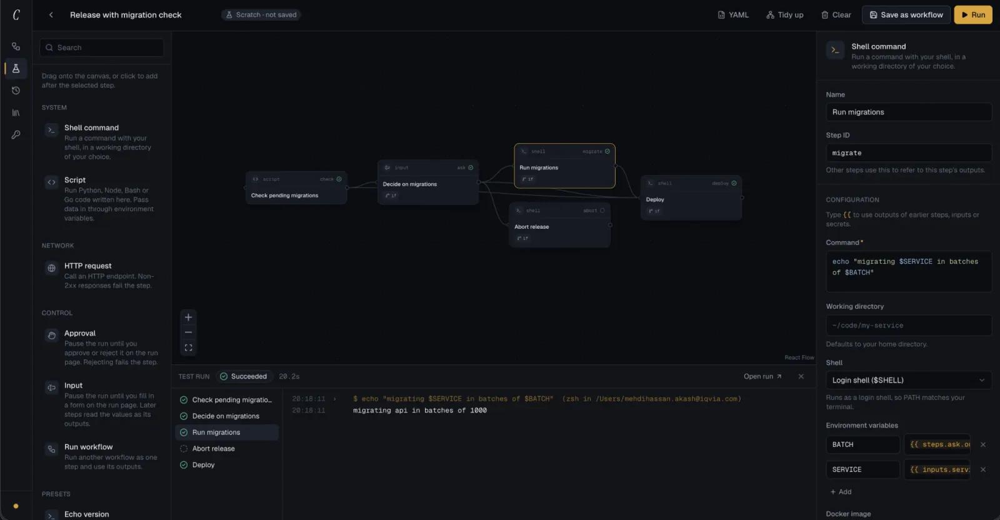

# Conductor

A personal workflow builder and task runner. Workflows are graphs of steps —
shell commands, scripts, HTTP calls, approvals and other workflows — that run with
dependencies and parallelism, and are edited and watched on a visual canvas.



Docs index: [docs/README.md](docs/README.md). Decisions:
[docs/adr](docs/adr).

## Requirements

- Go 1.27+
- Node 22+ and pnpm

## Development

```sh
make install   # frontend dependencies
make dev       # Go API on :7070, UI on http://localhost:5180
```

## Build

```sh
make build     # ./bin/conductor, UI embedded
./bin/conductor
```

The binary serves on `http://127.0.0.1:7070` and stores data in the user config
directory (`~/Library/Application Support/conductor` on macOS). Override with
`--addr` / `--data-dir` or `CONDUCTOR_ADDR` / `CONDUCTOR_DATA_DIR`.

## Layout

```
cmd/conductor     entrypoint
internal/config   flags and environment
internal/server   HTTP routes, middleware, UI serving
web/              React app (Vite, Tailwind, React Flow); embed.go exposes the build
docs/             index, architecture maps, recipes, YAML reference, ADRs
```
